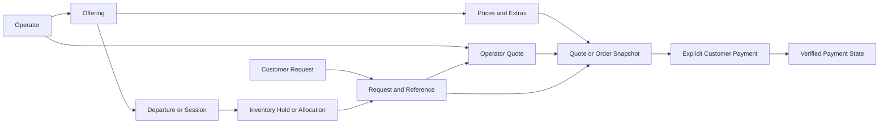

# Scuba Trip Products, Marketplace Booking, and Payments

Status: product direction and proposed implementation, not a record of shipped payment functionality.

Research date: 2026-10-27.

Team review: implementation is paused pending discussion. This document records the proposed scope and sequencing; it does not authorize application changes, schema deployment, account onboarding, or live payments.

## 1. Glaucus Is a Marketplace

Glaucus connects independent dive operators with customers who discover trips, see pricing, and book through the Glaucus website. It is not intended to be only a directory or an email lead-generation service.

The operator supplies the diving experience. Glaucus supplies discovery, the supplier portal, the booking experience, and payment integration. The contractual seller, payment responsibilities, and payout configuration still need to be decided before launch.

### Agreed direction

- Operators manage their trip offerings and prices through the portal.
- Customers can see prices and book through Glaucus.
- Operators can quote an individual trip request even when they have not published catalog pricing.
- Glaucus collects customer payment through its booking experience and retains an agreed platform fee or commission; the rate and fee allocation remain undecided.
- Glaucus customer service assists with booking conflicts using the accepted terms and booking history, subject to applicable rights and payment-provider rules.
- The business is intended to be US-headquartered, with a US-first rollout to keep the initial scope manageable.
- For bookings requiring operator confirmation, confirm availability and the final total before asking the customer to pay.
- The longer-term marketplace should accommodate local diving and international experiences such as liveaboards.

### Recommendations, not final decisions

- Start with US operators, USD prices, and local guided shore or boat outings.
- Start implementation with reference-based requests and operator quotes; a full public offering catalog is not a prerequisite.
- Support published fixed prices; do not require a bespoke quote for every purchase.
- Use request-to-book until availability is authoritative. Add instant confirmation only where inventory can be reserved reliably.
- Start with full payment for confirmed local outings. Add deposits and balances when the supported products require them.
- Consider Stripe Checkout with Stripe Connect for payments involving independent operators.
- Prefer an agreed commission deducted from the operator's price over a surprise customer surcharge. Rate, calculation basis, processing costs, and refund treatment require agreement before enabling payments.

## 2. What the Diving Industry Sells

A dive site is a destination, not usually the complete bookable product. Customers buy an operator-provided experience that has a duration, schedule, capacity, price, requirements, and terms.

| Product | What the customer buys | Common pricing basis | Capacity constraint |
| --- | --- | --- | --- |
| Guided shore outing | A guided session with one or more dives | Per diver/session or private group | Guide availability and group size |
| Scheduled boat outing | A place on a dated boat departure | Per diver/departure | Seats and operational limits |
| Private guided outing | A guide reserved for a party | Group rate, minimum charge, or per diver | Guide availability and group limit |
| Private boat charter | Exclusive use of a vessel for an outing | Per charter | Vessel availability and passenger limits |
| Course or refresher | Instruction and specified training activities | Per student/course | Instructor, equipment, and class capacity |
| Resort dive package | Accommodation combined with diving | Per person/stay or room/package | Rooms and dive capacity |
| Liveaboard voyage | Accommodation, meals, and diving on a scheduled voyage | Per person/voyage with occupancy rules | Cabins, berths, and vessel limits |

These are common patterns, not universal operator policies. A product can bundle equipment or charge for it separately.

## 3. Local Example: Monterey, California

### Typical experience

A customer might book a two-dive guided shore outing or a seat on a boat trip. They meet at a shop, beach, or harbor, complete check-in and equipment preparation, receive a briefing, and dive under the operator's procedures.

For guided shore diving, a named site may be a preference rather than a guarantee. Weather, swell, visibility, access restrictions, diver experience, and the guide's assessment can change the location or cancel the outing.

### Observed operator example

[Aquarius's guided group tour](https://aquariusdivers.com/charters/one-dive-guided-tour2) offers one- and two-dive shore tours in Monterey Bay, describing groups of up to 4-6 people. The operator states that the divemaster selects the location according to experience and conditions.

Its [private guided tour](https://aquariusdivers.com/charters/private-guided-tour) also offers one- and two-dive options. At the research date, the page described weekday-only private tours.

Current prices and equipment inclusions were not verified from those pages. These examples establish the product structure, not a rate to copy into Glaucus.

### Information a local outing needs

- Shore or boat access, duration, number of planned dives, meeting point, and local start time.
- Shared or private outing, minimum participants, maximum participants, and booking cutoff.
- Price unit: per diver, group, session, day, or charter.
- Included guide services, tanks, weights, exposure protection, and other equipment; separately priced extras.
- Certification and experience requirements, any refresher requirement, and operator-specific suitability checks.
- Rental sizes and availability where applicable.
- Weather cancellation, minimum-participant cancellation, rescheduling, no-show, and refund terms.
- Which sites are indicative versus explicitly promised, subject to safety and conditions.

## 4. Liveaboard Example: Nai'a, Fiji

### A different booking product

A liveaboard is a multi-day travel package, not just a collection of individual dive tickets. The customer selects a scheduled voyage and accommodation, often with occupancy restrictions and a package of diving, meals, and transfers.

The [Nai'a listing on LiveAboard.com](https://www.liveaboard.com/diving/fiji/naia?m=11/2026) illustrates:

- A departure-date selector and cabin information.
- A package that lists meals, diving, and transfers among its inclusions.
- Mandatory extras, including VAT and a fuel surcharge.
- Optional extras such as nitrox, rental equipment, and private guiding.
- A booking process that describes holding spaces before later payment confirmation.

The retrieved page did not expose a verifiable November 2026 departure schedule or departure-specific total. Headline daily prices are not confirmed checkout totals. Fees, inclusions, and terms must be rechecked with the operator for the selected voyage.

Liveaboards commonly use deposit and balance schedules, but no particular Nai'a deposit percentage or deadline was verified. Do not invent those terms or assume they apply to every operator.

### Information a liveaboard needs

- Vessel/operator, itinerary, embarkation and disembarkation ports, exact dates, and nights.
- Cabin categories, berth availability, shared/private occupancy, and any single supplement.
- Diver and non-diver rates, traveler eligibility, and operator-specific cabin-sharing rules.
- Planned diving, included meals and transfers, equipment, gases, and other services.
- Mandatory taxes, park or port charges, surcharges, and optional extras.
- What is payable online versus onboard, including the currency and basis of each charge.
- Deposit, balance deadline, cancellation schedule, insurance requirements, and change terms.
- Arrival/departure arrangements and operator guidance on flight timing after diving.

## 5. Monterey Versus a Liveaboard

| Dimension | Local Monterey outing | Fiji liveaboard |
| --- | --- | --- |
| Duration | A session or day | A multi-day voyage |
| Selection | Outing, date/time, divers, equipment | Voyage, departure, cabin/berth, travelers, extras |
| Inventory | Guide capacity, group places, or boat seats | Cabins and berths, constrained by occupancy rules |
| Accommodation | Usually outside the product | Core part of the product |
| Price | Often per diver/session or private party | Often per person/voyage and occupancy |
| Location | Site may be chosen for conditions | Itinerary and individual sites may change for conditions |
| Payment | Full payment can be practical | Deposit and later balance may be appropriate |
| Cancellation | Weather and short-notice operational issues | Voyage, travel, and longer cancellation schedules |

The underlying concepts can be shared, but a seat counter is not sufficient for cabin allocation. Liveaboard inventory and payment schedules should be a deliberate later extension, not improvised fields in a local-trip form.

## 6. Customer Booking Journeys

### Reference-based request and quote: recommended starting point

This flow lets customers book and pay through Glaucus without requiring operators to publish a trip catalog first.

1. Customer submits a trip request through the existing form or chat confirmation flow.
2. Glaucus durably saves the request and assigns a unique reference, for example `GL-7K9M-2Q8R`. This example is illustrative, not a production reference.
3. Customer and operator receive the same reference in their notifications. The request remains pending; a reference is not proof of confirmed availability or payment.
4. An authenticated, authorized operator supplies an itemized quote against that request, including availability, dates, inclusions, currency, total, expiry, and cancellation terms. An admin may assist under an explicit audited policy.
5. Customer opens the quote from their Glaucus dashboard or verifies guest access, reviews the price and terms, and explicitly chooses to pay.
6. Glaucus creates checkout from the current quote, verifies payment with the gateway, records the agreed commission, and updates the reservation under the accepted terms.
7. The same reference identifies later changes, receipts, refunds, and support conversations.

The operator supplies the trip price, not the customer or AI. Catalog price approval and booking-specific quote issuance are separate workflows: a private quote should not have to create a public listing first.

### Reference design and persistence

- Use a stable internal database ID plus a human-readable reference generated server-side with cryptographically secure randomness and a database uniqueness constraint. Retry a collision safely.
- Prefer a short, readable alphabet that avoids ambiguous characters. Do not include names, email addresses, or other personal data in the code.
- Keep one reference for the request's lifetime. Quote revisions, checkout attempts, payments, and refunds have their own IDs linked to that request.
- Reuse a client operation ID on ambiguous submission retries so the same logical request does not get multiple references or emails. A human-readable reference is not a substitute for an idempotency key.
- Save the canonical request before notifications and record notification state separately. The current best-effort log after email delivery cannot be the authoritative record for payments.
- Keep the reference consistent across form submissions, chat submissions, emails, customer views, operator views, and support tools.
- Never grant access based on the reference alone. It is an identifier that may appear in an email subject or support conversation, not a password or payment credential.
- For historical requests, any future reference backfill must be explicit, collision-safe, and non-notifying. Do not automatically resend old emails or mark historical requests paid or confirmed.

### Customer access and payment-link trust

Customers must be able to navigate directly to the known Glaucus website without clicking an unsolicited payment link.

| Customer | Access path | Authorization |
| --- | --- | --- |
| Signed-in customer | My Bookings -> booking reference -> Review Quote -> Pay | Authenticated ownership check on every request |
| Guest customer | Find Booking -> reference -> email verification -> Review Quote | Code or secure authentication flow sent only to the request's recorded email, creating scoped access |
| Customer using email | Notification says "Your quote is ready" and offers "View Quote" | Authenticated access or a private, expiring, revocable link scoped to that booking |

A reference and a typed email address are not sufficient proof of ownership. Rate-limit reference lookup, verification, and resend endpoints; use non-enumerating responses and bounded verification attempts. Do not let a lookup change the recorded recipient or expose booking details before verification.

Email is a notification and convenient entry point, not the only way to pay. The quote page should show the operator identity, reference, trip details, itemized total, amount due, expiry, and accepted terms before checkout. Do not ask customers to manually enter an amount against a reference or send money to an unverified account.

Store and audit quote versions and acceptance. A revision must invalidate obsolete unpaid checkout sessions and require customer acceptance of the new version. Define whether availability is held until the payment deadline or must be rechecked before checkout; do not charge against an expired availability commitment.

### Fixed-price, request-to-book

1. Customer selects a published offering, preferred departure/date, participants, and extras.
2. Glaucus shows the price and terms, clearly identifying any unconfirmed components.
3. Customer submits a request; the interface says it is pending, not confirmed.
4. Operator confirms availability and the final price. If anything changes, the customer reviews the revision.
5. Customer accepts the terms and explicitly chooses to pay.
6. Glaucus verifies payment and the valid reservation before showing the booking as confirmed under the operator's policy.

A fixed price does not require a custom quote, but it does not prove availability either. The operator can approve a request at its published price.

### Instant booking

1. Customer selects a departure with authoritative availability and a final price.
2. Glaucus atomically reserves the required places for a defined checkout period.
3. Customer explicitly pays through checkout.
4. Verified payment converts the valid hold into a confirmed reservation.
5. Expired or abandoned holds release inventory safely.

Instant booking requires concurrency protection, not just an editable number of remaining seats. Do not offer it when the operator also sells elsewhere without a reliable inventory process or integration.

### Customized trips and liveaboards

Use a quote when a private charter, group arrangement, itinerary, accommodation, or other variable component requires a tailored total. For liveaboards, select the voyage and cabin/occupancy before confirming the price and payment schedule.

Keep requests, provisional holds, confirmed reservations, payments, and completed trips distinct. Successful payment alone cannot establish that the operator delivered the experience.

## 7. Pricing and Payment Choices

### Transparent totals

Published offerings should identify their price unit and whether a price is exact or "from." Before payment, show the selected items, quantities, mandatory fees, applicable taxes, discounts, optional extras, amount due now, and any later balance.

Known mandatory charges must not be hidden behind a headline rate. If the total cannot yet be determined, use a pending-price or quote flow rather than presenting it as final. Clearly disclose any required charges collected by the operator separately.

Illustrative local-trip calculation, not an operator quote:

| Item | Calculation | Amount |
| --- | --- | --- |
| Guided outing | 2 divers x $150 | $300 |
| Rental package | 2 divers x $40 | $80 |
| Subtotal | | $380 |

Applicable taxes and mandatory charges would need to be determined and displayed before checkout; $380 is only this example's subtotal.

### Payment models

| Model | Advantage | Additional responsibility |
| --- | --- | --- |
| Full payment | Simplest balance tracking | Clear cancellation and refund policy |
| Deposit plus balance | Lower initial commitment on expensive trips | Due dates, balance collection, reminders, defaults, and refund allocation |
| Pay operator directly | Useful for non-payment-enabled listings | Must not be presented as payment collected by Glaucus |

Recommended initial model: full payment after confirmation for local outings. Deposit amounts and deadlines should be configured from operator-approved terms when supported, not inferred from industry averages.

### Glaucus revenue options

- Commission on a successful booking: aligns revenue with sales; rate, calculation basis, processing costs, and refund treatment require operator agreement.
- Customer service fee: makes platform revenue explicit, but adds checkout friction and requires clear disclosure and applicable legal review.
- Shop subscription: charges for business tools or platform access, independently of customer trip payments.
- Featured listings: a separate advertising product; paid placement should be clearly identified.

The current direction is for Glaucus to retain an agreed platform fee or commission. Subscriptions, buyer fees, and featured listings remain possible separate revenue options, not selected launch policies.

For illustration only, a 5% commission on a $200 commissionable booking is $10. If deducted from that price, the customer pays $200 and the operator's share is $190 before any processing costs allocated to it. This is not a selected rate or a promise of net payout. No commission percentage has been selected; even a deliberately waived-fee pilot would still incur Stripe processing and potentially Connect costs.

## 8. Operator Portal and Platform Responsibilities

### Operator portal

Operators should be able to create and maintain offerings, descriptions, price units, inclusions, extras, schedules, capacity, suitability requirements, and cancellation terms. Later booking tools should support availability confirmation, reservation management, and quote issuance where needed.

Existing portal listing changes use admin review. The pricing extension should initially follow that workflow: submitted changes remain pending until approved. Changes to a catalog price must not silently alter accepted quotes or existing bookings.

The current shareable portal link is not sufficient authorization for bank-account changes, refunds, customer booking records, or payment-account linking. Those require authenticated, explicitly authorized shop managers and suitable audit records. Professional affiliations must not be treated as business ownership.

### Glaucus administration

The platform needs operator approval, financial-access controls, fee configuration, booking/payment visibility, refund and dispute procedures, and reconciliation. Operators are the source of trip pricing. A pilot could use admin-entered quotes after recorded shop approval until authenticated shop quote tools are ready; it must not imply that Glaucus invents the operator's price.

### Customer service and conflict handling

Use the booking reference to find the accepted quote version, terms version, customer acceptance, operator availability commitment, communications, payment attempts, fees, and refunds. Record who changed a quote, approved a refund, or resolved a case and when.

Distinguish a service complaint, a cancellation request, a refund, and a card dispute. Customer service may coordinate a resolution under approved policies but must not silently change a paid quote or issue a refund without appropriate authorization. Terms and conditions cannot override statutory consumer rights or Stripe/card-network dispute rules.

## 9. Conceptual Data Model

These are proposed domain entities, not existing database tables or a final migration design.

| Entity | Purpose |
| --- | --- |
| Operator | The business supplying the experience |
| Offering | Reusable product, such as a two-dive guided shore outing |
| Departure/session | Specific local date/time or voyage dates, with an explicit timezone |
| Inventory allocation | Seats, guides, charter resources, or cabins/berths reserved for a booking |
| Price/add-on | Currency, integer minor-unit amount, unit, quantity rules, and effective version |
| Booking request/reservation | Customer intent, stable public reference, and subsequent operator commitment; may begin without a catalog offering |
| Quote/order snapshot | Accepted line items, totals, terms, expiry, and version |
| Payment schedule | Amount due now and any future installments |
| Payment attempt/refund | Provider references and independently tracked financial state |
| Operator payment account | Private mapping to the authorized connected account |
| Event inbox/outbox | Durable payment-event processing and notification delivery |

Conceptual relationship:

Use separate reservation, payment, refund/dispute, and notification states. A confirmed booking can have an unpaid balance; a successful payment can have a failed confirmation email. Store money as integer minor units with currency, and use deterministic server-side calculations.

A request can refer directly to an operator and a trip description without an offering or departure ID. Adding a catalog later must not invalidate those requests. Keep separate request/quote statuses such as `awaiting_quote`, `quote_ready`, `accepted`, `expired`, and `declined` from payment statuses such as `unpaid`, `processing`, and `paid`; final names are an implementation decision.

### Payment transactions and audit records

One canonical booking and reference should support both published-price and operator-quoted trips. The difference is where the accepted price originates, not a separate payment system.

Persist the following in the database with appropriate ownership checks, service-only writes for financial state, and retention/access policies:

- Booking identity, operator, customer association, and the stable readable reference.
- Immutable quote/order versions, itemized totals, currency, accepted terms, acceptance time, and actor.
- Payment attempts with their own internal IDs, operation/idempotency keys, gateway/account/environment scope, Checkout Session and PaymentIntent IDs, and lifecycle timestamps.
- Transaction records for verified financial movements, including refunds and application fees where applicable. Distinguish attempts from successful transactions; never count repeated webhook deliveries as additional revenue.
- Agreed platform commission and fee-allocation snapshots, with actual processing fees reconciled separately when available. Do not promise operator net proceeds from an estimated fee.
- Provider event IDs and durable processing outcomes, including retry/reconciliation state. Keep collected payments, operator transfers, bank payouts, and trip completion distinct.
- Append-only audit events for quote issuance/revision, acceptance, payment transitions, cancellation requests, refund approval, and support decisions. Corrections add traceable events rather than silently rewriting history.

Do not treat mutable application status or this operational transaction history as a complete accounting ledger. Define reconciliation, currency handling, and reporting responsibilities with the finance team. Never retain card numbers, CVCs, secret keys, or unnecessary raw customer/payment payloads in transaction or audit records.

## 10. Stripe Integration Direction

### Checkout and Connect solve different problems

- Stripe Checkout provides the customer payment interface.
- Stripe Connect supports relationships with independent operators and routing funds/fees according to the chosen configuration.
- Neither product defines trip inventory, guarantees availability, supplies cancellation terms, or automatically resolves tax obligations.

Stripe-hosted Checkout redirects the customer to Stripe and then back to the Glaucus booking page. It can still be part of a Glaucus-owned booking journey. Embedded Checkout is an alternative if keeping payment fields on the Glaucus domain is a firm requirement. The payment UI choice remains open.

### Funds flow is an explicit business decision

Direct charges put the charge on the connected operator's Stripe account and can collect an application fee for Glaucus. Destination charges create the charge on the platform and transfer funds to a connected account. Separate charges and transfers provide another model with additional reconciliation complexity.

Do not select a charge type solely because one seems easier to code. Confirm the contractual seller, customer statement/receipt identity, fee responsibility, refunds, disputes, negative balances, supported countries, and payout operations with Stripe and appropriate business/legal advisers. Responsibilities depend on the complete account configuration and agreements, not only the charge type.

Connect is not an escrow service. Charging a customer, transferring funds, and paying out to a bank are distinct events; delaying one does not remove platform obligations.

### Required safeguards

- Create checkout from an authorized, current server-side booking/quote snapshot. Never trust browser- or model-supplied amounts, fees, payment status, or payout accounts.
- Verify operator account authorization and payment readiness before enabling checkout. A completed onboarding redirect alone is not proof of readiness.
- Keep accepted prices and terms immutable; revisions require explicit acceptance and invalidation of obsolete unpaid checkout sessions.
- Use durable operation IDs, Stripe idempotency keys, and database uniqueness/locking to prevent duplicate reservations and charges.
- Verify webhook signatures against the raw request body and validate account scope, environment, amount, currency, and associated booking.
- Mark payment successful only after verified provider state. A browser redirect or `checkout.session.completed` event without a paid-state check is insufficient.
- Process duplicate and out-of-order events safely. Persist events and state transitions before acknowledgement or queue them durably for recovery.
- Keep notifications replay-safe and recoverable through a durable outbox/worker; do not rely on unawaited serverless background work.
- Handle races involving payment, quote expiry, inventory release, and cancellation by reconciliation, not by ignoring an actual charge.
- Track full/partial refunds, pending/failed refunds, disputes, and application-fee refunds separately. Do not assume processing fees are returned.
- Require explicit authorized confirmation for refunds. A conversational cancellation request must not automatically initiate a financial action.
- Give guests scoped, expiring, revocable booking access; do not expose customer records through supplier edit links or leak sensitive data into URLs, analytics, or Stripe metadata.
- Keep local secrets only in the untracked root `.env`; keep production secrets in the hosting provider's secret store. Examples contain placeholders only. Never store card details in Glaucus.
- Use Stripe sandbox/test mode for development; do not perform real charges in automated tests.

The AI chat may help customers discover offerings and collect booking preferences. It must not invent charge amounts, bypass canonical booking steps, or charge/refund without a separate explicit authorized action.

### Stripe sandbox and test cards

Use Stripe sandbox/test mode for the full integration before any live launch. These are Stripe's published synthetic test cards, not real customer cards; they must never be used against live-mode checkout.

| Scenario | Test card number | Expected result |
| --- | --- | --- |
| Successful card payment | `4242 4242 4242 4242` | Payment succeeds; the verified webhook updates the matching booking and transaction exactly once |
| 3D Secure authentication | `4000 0025 0000 3155` | Customer completes authentication before success; abandoned authentication must not mark the booking paid |
| Insufficient funds | `4000 0000 0000 9995` | Payment declines; the quote remains available for an eligible retry without recording a successful transaction |

For interactive testing, use a future expiry date, any three-digit CVC, and a valid-format postal code when requested. Use synthetic customer details. Do not use real cards or customer records, store card numbers/CVCs in Glaucus, or send card data directly from the Glaucus server. Automated server-side tests should use Stripe's documented test PaymentMethod identifiers or mocked provider responses rather than raw card-number requests.

Keep sandbox/test and live API credentials, webhook signing secrets, connected account IDs, and stored provider references separated by environment. Scope webhook processing to the expected environment and account. Use Stripe-hosted test onboarding for operator accounts; do not collect real bank credentials for test fixtures.

Test the complete journey, not only the payment form:

1. Submit a synthetic request, obtain its saved reference, and issue an operator-approved quote.
2. Verify signed-in and guest access resolve to the same current quote and amount due.
3. Pay using each relevant scenario above and verify the customer-facing result against server/provider state.
4. Confirm database payment attempts, successful transactions, commission snapshots, and audit events match the result; retain the booking reference across every step.
5. Replay duplicate webhooks, submit checkout concurrently, and simulate ambiguous timeouts or failed email delivery; none may produce a second logical charge or confirmation.
6. Exercise expired/revised quotes, abandoned checkout, full/partial refunds, account disconnection, and reconciliation after a processing failure.

Use Stripe CLI forwarding or a dedicated test webhook endpoint for end-to-end testing, including connected-account events where required by the chosen charge model. Sandbox tests do not prove live operator eligibility or settle legal, tax, fee, and cancellation policies.

## 11. Current Application Versus Proposed Marketplace

The existing application uses Nuxt, Vue, Supabase, Netlify, and Resend. Its booking endpoint sends booking requests by email. This is not yet a priced reservation and payment engine.

Relevant existing surfaces:

- [Booking email behavior](booking-email-flow.md): request notification, submission logging, and customer email order. Logging is currently best effort, which is not sufficient for financial state.
- [Business accounts and access model](accounts-workspaces-access-model.md): background for business permissions; do not assume the proposed model is already implemented.
- [Booking endpoint](../server/api/booking.post.ts): existing request submission path.
- [Booking form](../app/components/BookingForm.vue) and [chat interface](../app/components/chat/ChatHome.vue): customer submission entry points.
- [Partner portal](../app/pages/partner/[token].vue): supplier editing entry point.
- [Portal payload](../shared/shopPortalPayload.ts) and [submission application](../server/utils/applyShopSubmission.ts): existing proposal and approval integration points.
- [Shop detail](../app/components/DiveShopDetail.vue): a customer-facing surface for approved offerings and prices.
- [Supabase migration runbook](supabase-migrations.md): deployment procedure for future schema changes.

Do not relabel an existing "request sent" confirmation as a paid booking. Preserve the structured pre-send gate and existing review-verification meaning during migration: a verified booking review currently associates with a successfully sent request, not proof of payment or trip completion.

### Repurpose My Drafts as My Bookings

Reuse the existing combined draft/sent-request page instead of building a duplicate history page. The proposed customer destination is `/settings/bookings`, titled **My Bookings**.

- Move the existing page behavior from [settings drafts](../app/pages/settings/drafts.vue) to the proposed bookings route, preserving authentication, private-page SEO, draft resume/delete, and sent-request details.
- Start with **Drafts** and **Requests** tabs. Do not display unsupported payment or cancellation states just to fill the screen.
- Update the [settings menu](../app/pages/settings/index.vue) from My drafts to My Bookings and point it directly to the new route.
- Update the existing [legacy profile redirect](../app/pages/profile/drafts.vue) to point directly to `/settings/bookings`, avoiding a redirect chain.
- Keep `/settings/drafts` only as a thin compatibility redirect for existing bookmarks; all active internal navigation should use `/settings/bookings`.
- Keep draft API/database names and resume storage keys unchanged; they still describe real drafts rather than stale navigation.

Initially show actual account-owned sent requests with shop, requested dates, diver count, submission time, and **Request sent**. Display the human-readable reference only after it exists in the authoritative backend; do not invent one from part of a UUID. Distinguish loading, empty, and retryable failure states.

### Customer dashboard as the lifecycle grows

| Capability | Display or action | Backend prerequisite |
| --- | --- | --- |
| Request history | Drafts and sent requests | Existing authenticated request/draft reads |
| Booking references | Stable reference in list/detail and support | Durable reference creation |
| Quotes | Awaiting quote, quote ready, accepted, expired; Review Quote | Versioned operator quotes and scoped access |
| Amount due | Currency, accepted total, due now, and later balance if supported | Authoritative quote/order and payment schedule |
| Payments | Pay action, processing/paid/failed, receipts and refunds | Eligible checkout plus verified payment/transaction records |
| Trips | Confirmed upcoming reservations and past dated trips | Authoritative reservation lifecycle, not email-send status |
| Cancellations | Request cancellation, under review, approved or declined | Audited review workflow and accepted cancellation terms |

Keep one booking detail view as the common home for the quote/order, payments, trip, and support history. A separate Orders page is not necessary for the same underlying booking. Add filters or tabs only when real data supports them.

Past dates do not prove that a trip was completed, and a future request is not a confirmed upcoming trip. Missing payment integration means **Payment not tracked**, not a fabricated zero balance or an assumed paid/unpaid result.

For confirmed bookings, the agreed cancellation behavior is **Request cancellation**, followed by staff review. Track request, approval/decline, and any refund independently. A cancellation request neither immediately cancels the reservation nor automatically refunds a charge.

The three access paths in section 6 are the agreed direction: authenticated My Bookings, verified guest Find Booking, and optional secure quote-ready email links. A guest needs a separate verification entry point; the private settings page remains authenticated. Email links are convenient, not mandatory, and opening one must never accept terms or initiate payment. Re-check authorization on every quote, checkout, receipt, and cancellation request.

## 12. Suggested Delivery Phases

Recommended first vertical slice: **request -> durable reference -> operator-approved quote -> customer review -> verified payment**. Build and release the non-payment steps independently; do not require a complete offerings catalog to start.

Relative effort below is a sequencing aid, not a delivery estimate. Persistence, permissions, and payment work require implementation review even when the visible UI is small.

### Phase A: low-hanging starting work, no payments

| Work item | Relative effort | Dependency and definition of done |
| --- | --- | --- |
| Repurpose My Drafts as My Bookings | Small before quote/payment work | Reuse Drafts/Requests behavior, update active navigation and legacy redirects, preserve resume/delete and ownership checks |
| Canonical request and unique reference | Medium; foundational, not cosmetic | Save reliably before sending; enforce unique reference and idempotent request creation; record notification outcome independently |
| Reference in customer and shop emails | Small after persistence | Same reference in both emails and API response; email wording still says request, not confirmed booking |
| Reference in form/chat success screens | Small after persistence | Both entry points show the same saved reference and preserve explicit pre-send confirmation |
| Reference in existing admin booking views | Small after persistence | Authorized exact-reference lookup without adding a public lookup endpoint |
| Notification failure visibility | Small to medium | Admin can distinguish saved requests from delivered notifications; recovery cannot create another request or blindly duplicate messages |

Suggested first two implementation tickets, after team approval: (1) repurpose My Drafts into My Bookings and clean up route references; (2) add durable request identity and return/display the reference in both submission paths, then include it in notifications. Do not merely decorate a potentially failed best-effort submission log with a code. Preserve the existing review association and draft behavior with regression tests.

Acceptance for Phase A: a successfully saved new request has exactly one stable reference; repeated submissions with the same operation ID return that reference; notification failure does not lose the request; unauthorized users cannot retrieve it. No Stripe account, public catalog, deposit workflow, or commission rate is needed for this phase.

### Phase B: useful quoting workflow, still no money movement

| Work item | Relative effort | Dependency and definition of done |
| --- | --- | --- |
| Draft itemized quote with total, currency, expiry, and terms | Medium | Saved request; server validation and deterministic totals; no customer-entered payable amount |
| Admin-assisted quote entry | Medium | Existing admin authorization plus recorded operator approval and audit trail; optional pilot bridge, not permission to invent prices |
| Shop quote entry | Medium to large | Authenticated, approved shop-manager access; cannot rely on the current partner token |
| Extend My Bookings with quote detail | Medium | Reuse the Phase A page with ownership-scoped reads; keep request, quote, and payment states separate |
| Guest quote access | Medium | Reference plus email verification or private expiring link, scoped session, rate limits, and non-enumerating responses |
| Quote-ready notification | Small after quote/access work | Email points to the trusted Glaucus quote page; direct website/dashboard access also works |

Ship draft/view/accept quote behavior without a Pay button until payments are ready. Accepting a quote is not proof of payment or a confirmed reservation. Store the accepted version and terms; quote revisions require renewed acceptance. Prefer a single currency and full quoted amount in the first payment release.

### Phase C: payment prerequisites, not optional shortcuts

- Agree seller identity, commission calculation, processing-cost responsibility, taxes, cancellation, refunds, and dispute operations.
- Establish financial authorization and Stripe Connect onboarding, account mappings, capability/readiness checks, and disconnection handling.
- Choose hosted versus embedded Checkout and charge/account configuration. Keep secrets server-only and separate test/live state.
- Add immutable payable snapshots, availability commitments, concurrency controls, and a durable payment/event/notification lifecycle.

This work can overlap with Phase B but must finish before accepting real payments. Manual admin quote entry does not remove operator payment-readiness requirements.

### Phase D: smallest safe payment-enabled release

Support US pilot operators, USD quotes, and customer-initiated payment of the full accepted quote. Compute the agreed commission server-side and snapshot it with the payment. Do not make a published catalog mandatory.

- Create or reuse checkout idempotently for the authorized current quote; block expired, superseded, already-paid, or unavailable bookings.
- Verify signed webhooks and reconcile provider state, including wrong-account/environment checks and duplicate/out-of-order events.
- Show payment pending, successful, failed, or expired in the customer booking view; email failure must not undo payment.
- Operate a durable notification/reconciliation worker and a supported full/partial refund process. An authorized Stripe Dashboard refund workflow can precede a custom refund UI, but refund events and customer status still need reconciliation.
- Test cancellation/payment races, refunds, account readiness changes, and recovery in sandbox before enabling a small operator allowlist.
- Use a checkout feature flag; rollback stops new checkouts but leaves webhook processing, support access, and reconciliation running.

Do not treat a generic payment link, browser success page, or manual "mark paid" control as a substitute for this lifecycle.

### Phase E: defer until the reference-to-payment flow works

- Public offering catalog and portal price publishing, using existing admin review, old-payload compatibility, and atomic/stale-approval protection.
- Published-price booking using the same request reference, quote/order, and payment infrastructure.
- Reliable instant-booking inventory and external booking-system synchronization.
- Deposits, balance reminders, installment collection, and overdue-balance policies.
- Liveaboard voyages, cabin/berth allocation, occupancy rules, and travel-specific terms.
- International operator payouts, multicurrency, subscriptions, featured listings, and advanced revenue tools.

Public pricing can move earlier if needed commercially; it is not a technical dependency for paying an operator-issued quote. References do not solve inventory, and a simple payment screen does not make the financial backend a small task.

### Verification before live payments

- Unit and integration tests for amounts, rounding, approval, immutable quotes, permissions, and guest isolation.
- Reference uniqueness/collision tests, idempotent request creation, pre-notification persistence, and consistent form/chat/email references.
- Quote version/expiry/acceptance tests and proof that a reference alone or a typed email address cannot expose a booking or start unauthorized checkout.
- Concurrent booking/checkout tests, duplicate-click tests, ambiguous API timeout recovery, expired/revised quote handling, and inventory oversell protection where inventory is enabled.
- Signed-webhook tests for wrong signatures/accounts/environments, duplicate events, reordered events, database failures, and retry recovery.
- Stripe sandbox journeys for success, authentication, decline, abandonment, refunds, and account disconnection.
- Notification failure must not undo a successful payment or trigger another charge.
- Both form and chat request paths retain explicit confirmation and canonical booking order.
- Tax, fee, seller identity, cancellation, refund, dispute, and payout policies are approved before accepting real payments.

This document alone does not require code changes, new dependencies, migrations, or live resource operations.

## 13. Open Decisions

- Which local product types and operators participate in the pilot?
- Should the first quote-entry interface be shop self-service, admin-assisted with operator approval, or both?
- Does each offering use request-to-book, instant booking, or customized quotation?
- Who can confirm requests and issue revised quotes initially: authorized shop staff, admins coordinating with shops, or both?
- Who maintains authoritative availability, including sales through other channels?
- Is payment hosted or embedded? Account and verified guest access are intended; decide whether both ship in the first payment release.
- Who is the contractual seller, and which Connect account/charge configuration fits that relationship?
- Who bears processing/Connect fees, dispute losses, refunds, and applicable tax obligations?
- What is the agreed platform fee/commission, its calculation basis, and whether it is deducted from the operator price or added transparently to the customer total?
- What are the verification-code/session lifetimes, resend limits, and support recovery policy for guest access? Email links remain optional for customers who prefer direct website access.
- Are deposits required for the initial products? Who collects the remaining balance and when?
- What are each operator's weather, cancellation, no-show, and refund rules?
- Which mandatory charges, if any, are collected separately by the operator?
- What are the criteria for expanding beyond US operators and USD?

## 14. Sources and Limitations

Industry examples were reviewed on 2026-10-27. Operator availability, prices, inclusions, and policies can change; confirm them for the selected departure before publishing a payable total.

- [Aquarius guided group tour](https://aquariusdivers.com/charters/one-dive-guided-tour2).
- [Aquarius private guided tour](https://aquariusdivers.com/charters/private-guided-tour).
- [Nai'a on LiveAboard.com, with the requested November 2026 filter](https://www.liveaboard.com/diving/fiji/naia?m=11/2026). Specific November departures and totals were not verified from the retrieved content.
- [Stripe direct charges](https://docs.stripe.com/connect/direct-charges).
- [Stripe destination charges](https://docs.stripe.com/connect/destination-charges).
- [Stripe webhook documentation](https://docs.stripe.com/webhooks).
- [Stripe testing documentation and synthetic test cards](https://docs.stripe.com/testing).

Product examples illustrate industry patterns, not a promise of availability, operator partnership, inventory integration, or current pricing. Payment and marketplace recommendations are design proposals, not legal or tax advice.